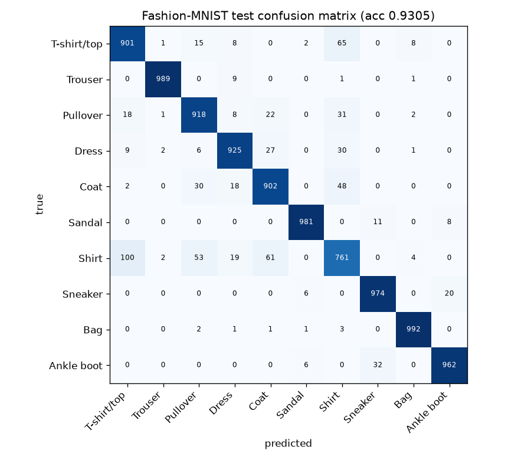
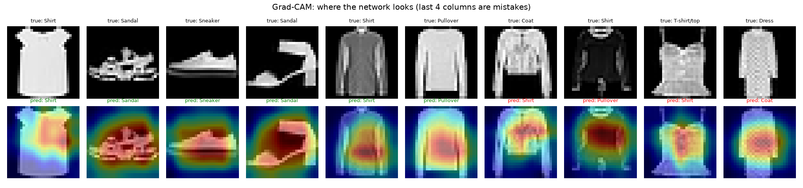

# Fashion-MNIST Residual CNN with Grad-CAM


A compact residual CNN, written from scratch in PyTorch, that classifies Fashion-MNIST clothing images,
plus Grad-CAM heatmaps that show which pixels drove each prediction and an error analysis of where the
model fails.

## Results (official 10,000-image test set)

| Metric | Value |
|---|---|
| Test accuracy (with flip TTA) | **93.05%** |
| Test accuracy (single pass) | 92.82% |
| Test macro-F1 | **0.930** |
| Parameters | 392K |
| Training | 7 epochs on a laptop CPU (~15 min) |

Test-time augmentation averages the prediction for an image and its mirror image. It was adopted because it
helped on the validation split (93.60% -> 93.80%), before the test set was scored.

Per-class F1: Trouser 0.992, Bag 0.988, Sandal 0.983, Ankle boot 0.967, Sneaker 0.966, Dress 0.931,
Pullover 0.907, Coat 0.896, T-shirt/top 0.888, **Shirt 0.785**.

The weakest class is *Shirt*; the most common mistake is **Shirt predicted as T-shirt/top (100 images)**.
These classes share silhouettes at 28x28 and differ mainly in collars and buttons, which the Grad-CAM maps
below show the model often does not look at.





## What is inside

- **Model** (`model.py`) - 3-stage residual network (BatchNorm, skip connections, global average pooling, dropout).
- **Training** (`train.py`) - AdamW, One-Cycle learning-rate schedule, label smoothing 0.1, checkpoint selection on a held-out 5k validation split (the test set is only used once, at the end).
- **Augmentation** - random shifts, horizontal flips and random erasing, implemented as batched tensor ops on the whole training tensor instead of per-image PIL transforms.
- **Explainability** (`gradcam.py`) - Grad-CAM on the last convolutional stage, vectorised over a batch.
- **Tests** - shape checks, Grad-CAM range, and an "overfit one batch" sanity test.

## Run it

```bash
pip install -r requirements.txt
PYTHONPATH=src python -m fashion_cnn.train            # CPU; add --cuda to use a GPU, --epochs / --width to scale up
pytest -q
```

Outputs go to `reports/` (`metrics.json`, confusion matrix, Grad-CAM figure).

## Next steps

- Wider network and longer schedule on a GPU (the run here was sized for a laptop CPU).
- A small ensemble of independently seeded models.
- Higher-resolution inputs or attention on the collar region to separate Shirt from T-shirt.

## License

MIT
